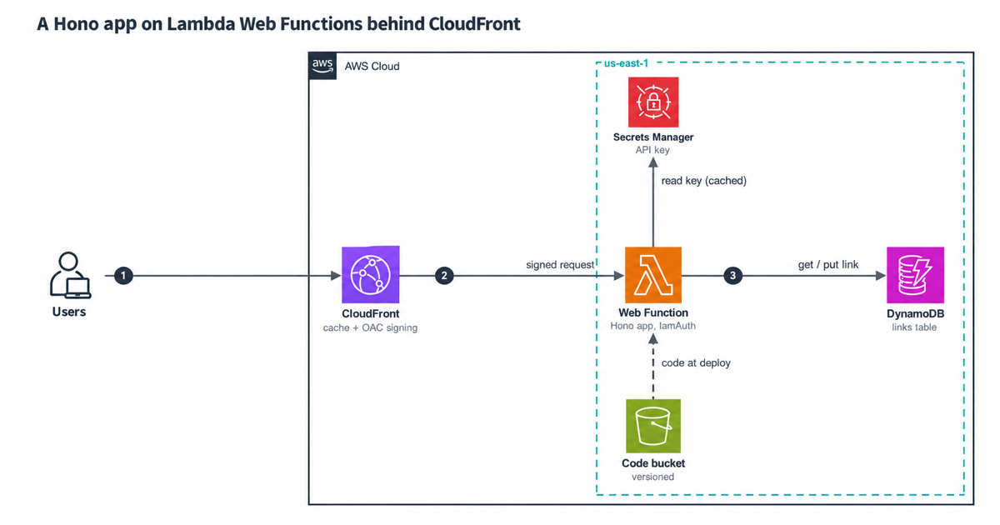

# A Hono app on Lambda Web Functions, private behind CloudFront

AWS Lambda Web Functions launched on 12 October 2026. They run a normal Node.js HTTP server on Lambda: your code listens on a port, and there's no handler to write. This repo is a small link service built that way, with Amazon CloudFront in front and Amazon DynamoDB behind.

It's written in AWS CDK (TypeScript). The tests run the real bundle as its own process against DynamoDB Local, the way the Web Function runtime runs it.



## What it does

| Route | What happens |
|---|---|
| `POST /api/links` | Creates a short link. Needs the `x-api-key` header. Returns 409 if the slug is taken. |
| `GET /<slug>` | 301 redirect. CloudFront keeps it for a day, so most redirects never reach Lambda. |
| `GET /healthz` | Returns `{"ok":true}` without touching anything else. |

## How it fits together

1. A viewer calls the CloudFront URL. CloudFront serves cached redirects itself.
2. For anything else, CloudFront signs the request with origin access control (OAC) and sends it to the Web Function endpoint.
3. The endpoint uses `IamAuth`, so it refuses anything unsigned. A resource policy lets in only this one distribution.
4. The Hono app answers. It reads and writes one DynamoDB table and reads its API key from AWS Secrets Manager.

The app in `app/src` doesn't know it runs on Lambda. `npm run dev` starts the same server on your machine.

## Three things that change when you move to Web Functions

**One environment serves 64 requests at once.** Classic Lambda gives each request its own environment, so a module-level `let currentUser` was safe there. Here it's shared by every request in flight. This app keeps per-request data in `AsyncLocalStorage` (`app/src/context.ts`). A test fires 300 concurrent requests at the real server and checks that each response carries its own request ID.

**You pay for memory while an environment exists, busy or not.** Each one has a fixed 2 GB. If it never shuts down, that's $19.01 for the month. The endpoint caps environments at 4, so the memory line can't pass $76.03, and [docs/cost.md](docs/cost.md) shows the math.

**Shutdown gets 1 second.** Lambda sends `SIGTERM` and then waits up to a second. The server stops taking connections and exits after 800 ms, even if a request is stuck.

## Deploy

You need Node.js 24, AWS credentials, and a CDK-bootstrapped account in a Region that has Web Functions (us-east-1, us-east-2, us-west-2, ap-northeast-1 or eu-west-1).

```bash
npm ci
npm run check                                  # type check, lint, tests, synth with cdk-nag
npm run deploy -- -c alertEmail=you@example.com
```

The stack prints `Url`, the CloudFront address. Read the API key from the `ApiKeySecretArn` output, then create a link:

```bash
KEY=$(aws secretsmanager get-secret-value --secret-id <ApiKeySecretArn> --query SecretString --output text)
curl -s -X POST "<Url>/api/links" -H "x-api-key: $KEY" -H 'content-type: application/json' \
  -d '{"url":"https://aws.amazon.com/lambda/","slug":"lambda"}'
curl -sI "<Url>/lambda"
```

## Tests

| Command | What runs | Needs |
|---|---|---|
| `npm test` | Unit tests, CDK template tests, cdk-nag, bundle checks | Nothing |
| `npm run test:int` | The real bundle as a separate process, against DynamoDB Local | Docker |
| `npm run smoke` | Checks against your deployed stack | A deploy |

To run the integration tests on your machine:

```bash
docker run -d --rm -p 8000:8000 amazon/dynamodb-local:3.3.2
AWS_ENDPOINT_URL_DYNAMODB=http://localhost:8000 npm run test:int
```

They check startup time, a burst sharing one Secrets Manager read, 20 requests racing for one slug, 300 concurrent requests keeping their own context, and a clean exit on `SIGTERM` while a request is half sent. Each of those was broken on purpose once to confirm the test fails.

The smoke test checks what only a deploy can: a direct call to the endpoint gets 403, and the second redirect is a CloudFront cache hit.

## Cost

At 1 million redirects a month, everything except Web Function memory comes to about $1.71 before the Free Tier. Memory adds $0 to $19.01 per environment, depending on how long Lambda keeps it. AWS doesn't document that. [docs/cost.md](docs/cost.md) has the full model and when a classic Lambda function is cheaper.

## More docs

- [docs/security.md](docs/security.md): how the endpoint stays private, and what we chose not to add
- [docs/cost.md](docs/cost.md): the pricing model, worked out
- [docs/runbook.md](docs/runbook.md): what to do when the alarm fires

## Clean up

```bash
npm run destroy
```

The stack keeps the `Links` table on purpose. Delete it in the DynamoDB console when you're sure.

---

Created by Rahul Ladumor / InfraTales, under the MIT-0 license
